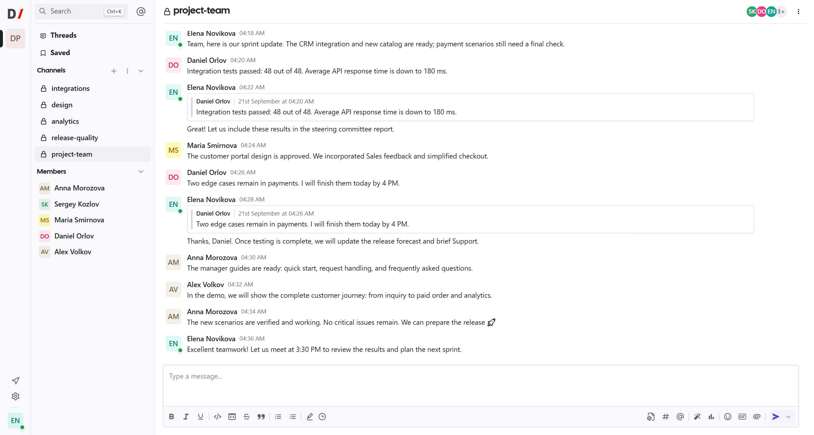

[Русский](README.ru.md)

<!-- dinext-presentation:start -->
<p align="center">
  <a href="https://dinext.ru"></a>
</p>
<h1 align="center">Dinext Huf Raven</h1>

<hr>

<p align="center">Ask about ERP records and confirm business actions in Raven. Huf runs the assistant with the employee's Frappe permissions.</p>

<p align="center">
  
</p>
<p align="center"><sub>Raven on the Dinext demo site, with fictional participants.</sub></p>

<p align="center">
  <a href="https://dinext.ru">Website</a> · <a href="https://docs.dinext.ru">Documentation</a>
</p>
<!-- dinext-presentation:end -->

## Task

Bring the business tools previously used through Frappe Assistant Core (FAC) into the Raven conversations where Dinext employees work. [Raven](https://github.com/frappe/raven) handles messages, channels and threads. The [Dinext Huf fork](https://github.com/Dinext-pro/huf) handles model configuration, agent runs and conversation history. This app connects them and defines the Dinext tools, permission checks and decisions.

## Use the assistant

Send a direct message to the configured Raven bot, or mention it in a channel. Continue in the thread created for the request. In a channel or thread, Raven shows a short acknowledgement and the bot delivers the answer and downloadable results in a private conversation with the requester. Each user's history is scoped to their conversation. The app starts a fresh Huf conversation if the user loses access to a previous input or if the bounded history has expired.

When the assistant proposes an ERP change, its private message describes the change and includes commands to confirm or reject it. Copy the relevant command into that conversation. The app checks permissions and the current record version again before applying the change. Confirmation codes expire and apply to one proposal.

## Install on Frappe 15

Use a WSL bench with Python 3.12, Node.js 22 and Raven 3.2. The integration was developed on `feat/dinext_ai`. For the Frappe 15 installation, use Huf commit `ea6b0df3fb55e73376e1e1471b34ccb94750766e` from the fork's `dinext/main/develop` branch. Clone the apps into the bench's `apps` directory.

From the bench root, prepare the Huf installation view and install both Python packages.

```sh
env/bin/python apps/dinext_huf_raven/scripts/huf_v15_profile.py apps/huf \
  --constraints env/share/dinext-huf-v15/constraints.txt
env/bin/pip install -c env/share/dinext-huf-v15/constraints.txt \
  -e env/share/dinext-huf-v15 -e apps/dinext_huf_raven
```

The view references the original checkout and makes optional vector backends an extra. On an existing bench where another app manages a supported LiteLLM release, add `--use-bench-litellm` to the profile command to keep that app's version. The default bench uses Frappe's Redis 4.5 client. Add `huf` and `dinext_huf_raven` once to `sites/apps.txt`, then clear the cache before installing them. Run the migration and build the assets after installation. Build the Huf management interface with its lockfile. Install Tesseract with `eng` and `rus` on the worker's PATH if employees need OCR.

```sh
bench --site localhost clear-cache
bench --site localhost install-app huf
bench --site localhost install-app dinext_huf_raven
(cd apps/huf/frontend && npm ci && npm run build)
bench build --app dinext_huf_raven
bench --site localhost migrate
bench --site localhost clear-cache
```

Keep the long and default queues and the scheduler running. An administrator provisions a Raven bot and a dedicated Huf agent, selects an AI Model and enables routing in **Dinext AI Settings**. Grant Huf's `agent.use` capability to the employees who will use the bot. The `users` argument limits a new agent to the given accounts. When omitted, the agent uses the `Huf User` role. The app starts with routing disabled.

```sh
bench --site localhost execute dinext_huf_raven.setup.provision \
  --kwargs '{"raven_bot":"Dinext Assistant","agent":"Dinext-Raven","model":"MODEL_ID","users":["employee@example.invalid"]}'
bench --site localhost execute dinext_huf_raven.setup.activate \
  --kwargs '{"raven_bot":"Dinext Assistant","agent":"Dinext-Raven"}'
```

For Yandex AI Studio, run `scripts/configure_yandex.py` with the bench Python, the selected `--cloud-id`, `--folder-id` and `--site localhost`. The configured YC profile needs permission to manage the folder's service accounts, role bindings and API keys. The script scopes the account to `ai.languageModels.user` in the folder, creates a language-model API key and stores it in the Huf password field. It registers the model as `openai/gpt://<folder>/<model>` for the OpenAI-compatible API. The default model path is `yandexgpt/latest`. [Yandex Cloud model configuration](https://yandex.cloud/en/docs/tutorials/serverless/create-ai-agent-function)

## FAC capabilities

| Need | Raven and Huf |
| --- | --- |
| Discover records and metadata | DocType and field discovery, document lists and reads, global and DocType search, link lookups |
| Change an ERP record | Create, update, delete, submit, cancel and apply workflow transitions after a private confirmation |
| Find approvals and run reports | Current user's pending workflow actions, report filters and runs, CSV and XLSX report exports |
| Analyze business data | Bounded SQL queries and Python DataFrame operations over permission-filtered projections, with the selected record window in the result. PNG charts arrive in the private conversation |
| Read attachments | Text, CSV and Office documents, PDF text and tables, and image OCR when Tesseract is installed |
| Work with dashboards | Read permitted dashboards and propose persistent Frappe dashboard and chart changes |
| Reuse instructions | Read permitted Huf skills and prompt templates with named substitutions. Register packaged tool handlers in Huf |

## Verify on localhost

The acceptance fixture uses two synthetic users and Huf's deterministic test provider. It checks a private chat, a mention and thread, a single reply after repeated delivery, permission changes and confirmed changes to ERP records. Run the fixture while Raven push notifications are disabled on the development site.

```sh
bench --site localhost execute dinext_huf_raven.tests.acceptance.run
bench --site localhost run-ui-tests dinext_huf_raven --headless --browser electron
```
