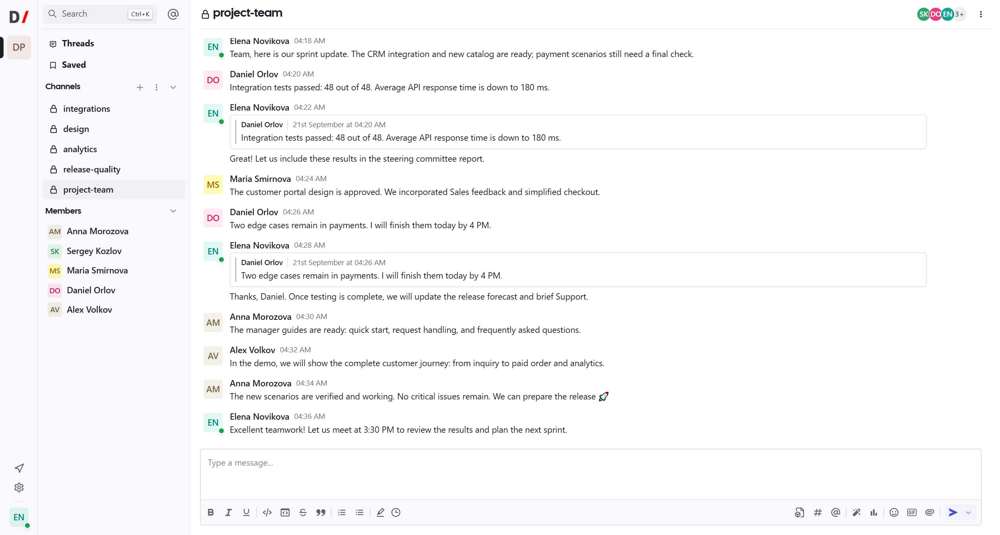

[English](README.md)

<!-- dinext-presentation:start -->
<p align="center">
  <a href="https://dinext.ru"></a>
</p>
<h1 align="center">Dinext Huf Raven</h1>

<hr>

<p align="center">Запрашивайте данные ERP и подтверждайте операции в Raven. Huf запускает ассистента с правами сотрудника во Frappe.</p>

<p align="center">
  
</p>
<p align="center"><sub>Raven на демосайте Dinext с вымышленными участниками.</sub></p>

<p align="center">
  <a href="https://dinext.ru">Сайт</a> · <a href="https://docs.dinext.ru">Документация</a>
</p>
<!-- dinext-presentation:end -->

## Задача

Перенести бизнес-инструменты Frappe Assistant Core (FAC) в Raven, где сотрудники Dinext уже обсуждают работу. [Raven](https://github.com/frappe/raven) отвечает за сообщения, каналы и треды. [Форк Huf в Dinext](https://github.com/Dinext-pro/huf) хранит настройки моделей и историю разговоров и запускает агентов. Это приложение связывает их, предоставляет инструменты Dinext и проверяет доступ и подтверждения.

## Работа с ассистентом

Напишите боту Raven в личном чате или упомяните его в канале. Продолжить обсуждение можно в треде запроса. В канале или треде Raven показывает короткое уведомление, а ответ и файлы для скачивания бот присылает лично автору. История принадлежит сотруднику и его диалогу. Приложение начинает новый разговор в Huf, когда доступ к прежним данным изменился или история достигла установленного лимита.

При предложении изменить запись ERP ассистент присылает описание операции и команды подтверждения и отклонения. Скопируйте нужную команду в личный чат. Перед записью приложение повторно проверит права и версию документа. Код действует ограниченное время и относится к одной операции.

## Установка на Frappe 15

Используйте WSL bench с Python 3.12, Node.js 22 и Raven 3.2. Ветка разработки интеграции — `feat/dinext_ai`. Для Frappe 15 используйте коммит Huf `ea6b0df3fb55e73376e1e1471b34ccb94750766e` из ветки форка `dinext/main/develop`. Клонируйте приложения в каталог `apps` вашего bench.

Из корня bench подготовьте профиль установки Huf и установите оба Python-пакета.

```sh
env/bin/python apps/dinext_huf_raven/scripts/huf_v15_profile.py apps/huf \
  --constraints env/share/dinext-huf-v15/constraints.txt
env/bin/pip install -c env/share/dinext-huf-v15/constraints.txt \
  -e env/share/dinext-huf-v15 -e apps/dinext_huf_raven
```

Профиль ссылается на исходную копию Huf и выносит зависимости векторных хранилищ в отдельную опцию. Если поддерживаемая версия LiteLLM уже установлена для другого приложения, добавьте к команде подготовки профиля `--use-bench-litellm`, чтобы сохранить эту версию. В bench используется клиент Redis 4.5, с которым работает Frappe. Добавьте по одной строке `huf` и `dinext_huf_raven` в `sites/apps.txt`, затем очистите кеш перед установкой. После установки выполните миграцию и сборку ресурсов. Соберите панель администрирования Huf по lockfile. Для OCR добавьте Tesseract с моделями `eng` и `rus` в PATH воркера.

```sh
bench --site localhost clear-cache
bench --site localhost install-app huf
bench --site localhost install-app dinext_huf_raven
(cd apps/huf/frontend && npm ci && npm run build)
bench build --app dinext_huf_raven
bench --site localhost migrate
bench --site localhost clear-cache
```

После установки Python-пакетов в работающий bench перезапустите веб-процесс, воркеры и планировщик. Оставьте запущенными очереди long и default и планировщик. Администратор создаёт бота Raven, назначает ему выделенного агента Huf, выбирает AI Model и включает обработку в **Dinext AI Settings**. Сотрудникам требуется разрешение Huf `agent.use`. Аргумент `users` ограничивает доступ к новому агенту указанными учётными записями. Если его опустить, агент будет доступен роли `Huf User`. После установки обработка сообщений выключена.

```sh
bench --site localhost execute dinext_huf_raven.setup.provision \
  --kwargs '{"raven_bot":"Dinext Assistant","agent":"Dinext-Raven","model":"MODEL_ID","users":["employee@example.invalid"]}'
bench --site localhost execute dinext_huf_raven.setup.activate \
  --kwargs '{"raven_bot":"Dinext Assistant","agent":"Dinext-Raven"}'
```

Для Яндекс AI Studio запустите `scripts/configure_yandex.py` через Python из bench и передайте `--cloud-id`, `--folder-id` и `--site localhost`. У настроенного профиля YC должны быть права управления сервисными аккаунтами, ролями и ключами API в выбранном каталоге. Скрипт выдаст сервисному аккаунту роль `ai.languageModels.user` в каталоге, создаст ключ для языковых моделей и сохранит его в защищённом поле Huf. Модель для API с интерфейсом OpenAI регистрируется как `openai/gpt://<folder>/<model>`. По умолчанию используется путь `yandexgpt/latest`. [Настройка модели в Yandex Cloud](https://yandex.cloud/ru/docs/tutorials/serverless/create-ai-agent-function)

## Возможности FAC

| Задача | Raven и Huf |
| --- | --- |
| Найти документы и их поля | Поиск типов и полей, списки и чтение документов, глобальный поиск, поиск по типу и полям Link |
| Изменить запись ERP | Создание, обновление, удаление, проведение, отмена и переходы workflow после подтверждения в личном чате |
| Найти согласования и запустить отчёт | Действия workflow текущего сотрудника, фильтры и запуск отчётов, экспорт в CSV и XLSX |
| Проанализировать данные | SQL-запросы и операции Python DataFrame над выборкой с учётом прав. Границы выборки указываются в результате. Графики PNG приходят в личный чат |
| Прочитать вложения | Текст, CSV и документы Office, текст и таблицы PDF, распознавание изображений с Tesseract |
| Работать с дашбордами | Просмотр доступных дашбордов и предложения создать или изменить дашборды и диаграммы Frappe |
| Использовать готовые инструкции | Чтение доступных навыков и шаблонов Huf с именованными параметрами, регистрация инструментов приложения в Huf |

## Проверка на localhost

Тестовый сценарий создаёт двух синтетических пользователей и использует детерминированный провайдер Huf. Он проверяет личный чат, упоминание и продолжение в треде, один ответ при повторах, изменение прав и подтверждённое изменение ERP. Запускайте сценарий на стенде с отключёнными push-уведомлениями Raven.

```sh
bench --site localhost execute dinext_huf_raven.tests.acceptance.run
bench --site localhost run-ui-tests dinext_huf_raven --headless --browser electron
```

После настройки Яндекс AI Studio проверьте личный чат с зарегистрированной корпоративной моделью.

```sh
bench --site localhost execute dinext_huf_raven.tests.acceptance.run_corporate --kwargs '{"model":"MODEL_ID"}'
```
